<div align="center">



<br/>

<a href="https://git.io/typing-svg"></a>

<br/>

[](https://github.com/ManuelAmell)
[](mailto:manuelfcoamell@gmail.com)
[](https://www.linkedin.com/in/manuel-amell-19b4a0398)

</div>


<table>
<tr>
<td width="45%" valign="top" align="center">

</td>
<td width="55%" valign="top" align="center">

</td>
</tr>
</table>

```text
> I build software that ships: multi-tenant SaaS, point-of-sale systems, real-time apps,
> vision-AI pipelines and the homelab they run on. Systems Engineering student by day,
> agent-orchestration tinkerer by night.
```


<div align="center">

**`// languages`**


**`// frontend`**


**`// backend & data`**


**`// infra & tooling`**


<br/>


</div>


<table>
<tr>
<td width="50%" valign="top">

### 🏋️ [AdminFit](https://github.com/ManuelAmell/AdminFit)
**Multi-tenant SaaS for gyms in Colombia.** Members, memberships and payments in one place.

- 🔐 Tenant isolation enforced by **Postgres Row Level Security**
- 👤 Better Auth + platform superadmin console
- 🧪 Vitest + Playwright, incl. a tenant-isolation test

`Next.js 16` `TypeScript` `PostgreSQL` `Drizzle` `shadcn/ui` `Docker`

</td>
<td width="50%" valign="top">

### 📚 [Amellify v3](https://github.com/ManuelAmell/Amellify)
**Self-hosted university schedule & grade tracker.** Your semester, your data.

- 🗓 Interactive visual timetable + weighted grade calculator
- 🤖 AI assistant via the AI SDK (Gemini / Groq)
- 📴 Offline-first PWA (Serwist), one-command Docker deploy

`Next.js 16` `React 19` `PostgreSQL 17` `Drizzle` `Better Auth` `Docker`

</td>
</tr>
<tr>
<td width="50%" valign="top">

### 🍔 [MonsterBurguer POS](https://github.com/ManuelAmell/MonsterBurguer)
**End-to-end restaurant POS.** Touch ordering, kitchen screen, cashier and admin.

- ⚡ Real-time kitchen display (KDS) over **Server-Sent Events**
- 📦 Recipe-based stock with `SELECT … FOR UPDATE` (no overselling)
- 🛡 argon2id, opaque sessions, CSRF checks, login rate limiting

`TypeScript` `pnpm monorepo` `PostgreSQL` `Docker`

</td>
<td width="50%" valign="top">

### 🚦 [PeajeSys](https://github.com/ManuelAmell/PeajeSys)
**Toll-station management & revenue auditing.** Built for the Databases course.

- 🚗 Vehicle categories I–VII with per-station dynamic rates
- 💳 Cash + RFID tele-toll with real-time balance checks
- 🧾 Immutable audit trail via PostgreSQL triggers, ACID shifts

`PostgreSQL` `C# / .NET` `TypeScript` `GitHub Actions`

</td>
</tr>
<tr>
<td width="50%" valign="top">

### 🎓 [QQSI — Who Wants to Be an Engineer?](https://github.com/ManuelAmell/QQSI)
**Real-time multi-screen quiz system** for the inter-faculty contest.

- 📡 Auditorium, team phones and jury desk synced via Socket.IO
- ⏱ Speed bonuses + dynamic point reassignment
- ∑ KaTeX equations and Prism.js code questions

`Node.js` `Express` `Socket.IO` `Docker`

</td>
<td width="50%" valign="top">

### 🎬 [AniMDB](https://github.com/ManuelAmell/animdb)
**Personal anime & film tracker** for web and desktop.

- 📋 List, Ranking, Kanban and mood-theme views
- 📥 Import from AniList, MAL, Trakt, Letterboxd
- 🌐 Installable PWA + Electron, live sync with Socket.IO

`TypeScript` `Vite` `Express` `SQLite` `Electron`

</td>
</tr>
<tr>
<td width="50%" valign="top">

### 🛡️ [Paladines de la Vida](https://github.com/ManuelAmell/paladines-de-la-vida)
**Social-impact platform prototype** for the *Tapotón* campaign (Universidad del Atlántico).

- 🧭 Public landing, admin, member and partner portals
- 🛡 Code-generated SVG armor ranks & badges
- 📊 Charts, QR invites, rankings

`Next.js` `React` `shadcn/ui` `Framer Motion` `Recharts`

</td>
<td width="50%" valign="top">

### 🌴 [Conéctate Cartagena](https://github.com/ManuelAmell/Hackathon-Cursor-Conectate-Cartagena)
**Cursor Hackathon build:** a mobile-first app connecting young people in Cartagena with jobs, training and open calls.

- 🗺 Interactive map with walking routes (Leaflet)
- 🤖 Gemini helps publish calls and write CVs
- 📱 Mobile-first feed of opportunities

`React 19` `TypeScript` `Vite` `Tailwind` `Gemini`

</td>
</tr>
<tr>
<td width="50%" valign="top">

### 🚤 [Tierra Bomba Lancha Racing](https://github.com/ManuelAmell/Supabase-Hackathon-3er-place)
**🏆 3rd place, Supabase Hackathon.** 2D boat racing from the open sea to Tierra Bomba.

- 🎮 Phaser arcade physics, obstacles, progress HUD
- 🏁 Live top-10 leaderboard + cloud saves

`Phaser` `Supabase` `Vite`

</td>
<td width="50%" valign="top">

### 🛰️ [Imágenes Espectrales](https://github.com/ManuelAmell/Imagenes-Espectrales)
**Material detection in hyperspectral images** of Cartagena (750×750 px, 380 bands).

- 📈 Spectral-signature **arc length** similarity per pixel
- 🌊 Water / material maps with outlier-robust thresholds

`Python` `NumPy` `OpenCV` `scikit-learn` `Jupyter`

</td>
</tr>
<tr>
<td width="50%" valign="top">

### 🎙️ [SARITA](https://github.com/ManuelAmell/SARITA)
**Voice for your coding agent:** a TTS hook for the Antigravity IDE.

- 🔊 Non-blocking background speech, bilingual ES/EN
- ✋ Barge-in: new replies interrupt the old audio (lockfile mutex)

`Python` `uv`

</td>
<td width="50%" valign="top">

### 🧩 [libreuml-diagram-skill](https://github.com/ManuelAmell/libreuml-diagram-skill)
**Agent skill** that scans Java projects and generates LibreUML `.luml` v2 diagrams.

- 🔍 Classes, interfaces, relationships & multiplicity
- ✅ Bundled `.luml` validator + examples

`Agent Skills` `Python` `Java`

</td>
</tr>
</table>

<details>
<summary><b>🧪 The lab: <a href="https://github.com/ManuelAmell/Programming-Exercises">Programming-Exercises</a></b> (where it all started, Apr 2025)</summary>

<br/>

```text
Programming-Exercises/
├── C++/          file I/O · matrices · data structures · port scanner · Dijkstra · ASCII games
├── PYTHON/       automation · backups · camera mouse · email bots · AI · chess · PDF tools
├── JAVA/         HackerRank (easy → hard) · OOP workshops · encapsulation
├── JAVASCRIPT/   fundamentals · objects · factories · constructors
├── TYPESCRIPT/   typed experiments
└── HTML/         web fundamentals
```

Also: [**AmellCode++**](https://github.com/ManuelAmell/AmellCode-), my first minimal C++ IDE (Qt · C++ · Makefile), and [**Enchiladitos**](https://github.com/ManuelAmell/Enchiladitos), a POS + CRM for a snack business (React · Supabase).

</details>


> Private and client builds. Source is restricted; descriptions only.

| | Project | What it does | Stack |
|:-:|---|---|---|
| 🔒 | **Purchase-Sheet Digitizer** | Turns phone photos of handwritten purchase orders for a retail chain into validated data: Gemini structured outputs, 14 accounting rules, fuzzy catalog matching, human review UI, `.docx` export | `FastAPI` `SQLAlchemy` `React` `Gemini` `Docker` |
| 🔒 | **CEISync** | Finds the best meeting slots for the Systems Engineering Student Council from everyone's class schedules (heat map + ranked windows) | `Python` `pytest` |
| 🔒 | **PhiShield** | CTW Hackathon 2026: phishing & scam link scanner with community reports and a WhatsApp bot | `React` `Supabase` `VirusTotal` |
| 🔒 | **AmellOS** | Debian home server: Dockerized media & admin stacks, Tailscale exit node, automated backups | `Debian` `Docker` `Tailscale` `Bash` |
| 🔒 | **MATE Facturas** | Invoicing web app with PDF + QR invoices | `React` `Express` `MySQL` `Sequelize` |
| 🔒 | **CleanCare Hogar** | Landing site for a home-cleaning business | `React` `Tailwind v4` |


```diff
+ 🏆 3rd place: Supabase Hackathon            → Tierra Bomba Lancha Racing
+ ⚡ Cursor Hackathon builder                  → Conéctate Cartagena
+ 🛡 CTW Hackathon 2026                        → PhiShield
+ 🎓 Tools for CEIS (Student Council, UdeC)    → CEIS_HUB · CEISync · QQSI
+ 🚀 Real software for local businesses             → retail · food · fitness
```


<div align="center">


</div>


```text
[✓] C++ · Java · Python      OOP, algorithms, data structures, automation
[✓] JavaScript / TypeScript  Next.js, React, Node, Express, Vite
[✓] SQL / PostgreSQL         modeling, 3NF, triggers, RLS, transactions
[✓] REST & real-time APIs    FastAPI, Express, Socket.IO, SSE
[✓] Docker · Linux · Git     daily driver: Arch + Hyprland, self-hosted homelab
[~] Cloud & DevOps           CI pipelines, deployments, observability
[~] AI agents & tooling      multi-agent orchestration, skills, LLM pipelines
[~] C# / .NET                backend services
[ ] Kubernetes               container orchestration at scale
[ ] Distributed systems      queues, consensus, event-driven design
```


<div align="center">

> *"The people who are crazy enough to think they can change the world are the ones who do."*
> **— Steve Jobs**


</div>


